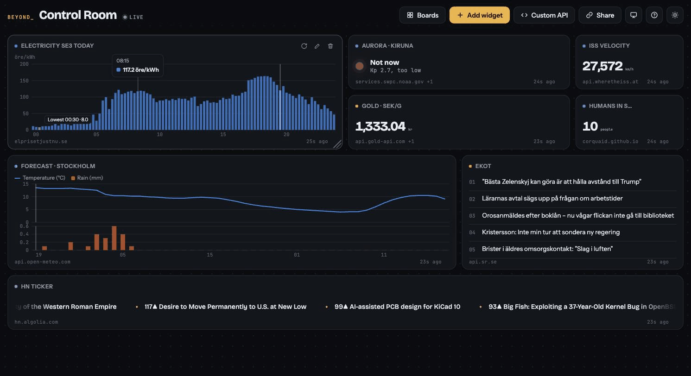

# BEYOND_DASHBOARD

A modular dashboard for the internet's weirdest live data. Pick a module, choose what to show and where (UV index in the Sahara, waves at Point Nemo, your own city's pollen), drag it anywhere on the board, connect your own endpoints and share the whole layout as a link.

No backend, no build step, no account. Open `index.html`, or try it live: **[rydenjesper.github.io/Beyond-Dashboard](https://rydenjesper.github.io/Beyond-Dashboard/)**



## Run it

Open `index.html` in a browser. That's it.

To host it: push the folder to GitHub and turn on GitHub Pages.

## What it does

- **Two-step setup**: first visit asks where home is and what you're into, then builds a personal board (your city's weather, your Swedish electricity zone, launches if you like space) and runs a five-tip tour. Rebuild any time from the widget bank; replay the tour with the ? button.

- **Modules**: 48 configurable widget types. Weather, air quality, ocean and sun work for any place on Earth (search or pick an absurd preset). Swedish electricity spot prices per zone, Swedish police events per county, SL departures from any Stockholm stop, Sveriges Radio live, rocket launch countdowns, NASA asteroids, chess ratings, F1 standings, public holidays, crypto, exchange rates, GitHub repos, npm packages, 14 status pages, earthquakes, Wikipedia and Hacker News each have their own options.
- **Charts**: today's electricity price quarter by quarter with the cheapest slot marked, a 48-hour forecast, crypto, Wikipedia page views, earthquakes per hour, ECB rates, Eurostat inflation and unemployment, Sweden's electricity use. Hover for exact values. Every number widget can also be drawn over time ("History"); its last 200 values survive a reload.
- **Combined widgets**: one widget, several APIs, one answer. Gold in kr/gram, "Can I see the northern lights tonight?" (aurora strength + clouds + darkness), how far the ISS is from you, whether electricity is cheap right now, an umbrella check for your next SL bus, a morning brief. Build your own in the editor: add sources, name them, write a calculation like `gold * fx / 31.1035`.
- **Personal widgets**: to-do lists, notes with simple formatting, a pomodoro timer, world clocks, countdowns, the moon's phase and how much of the year has gone. No API; what you write stays on your device and is never part of a share link.
- **Several boards**: tabs on desktop, a list on mobile, keys 1–9 to switch. Each board can have its own home city for new widgets.
- **Ready-made widgets**: 95 one-click widgets, from South Pole temperature to Critical Cat Facts. All key-less and tested to work from a browser (CORS).
- **Free-form board**: drag a widget by its header and the others move out of the way. Drag the corner to resize (1–6 columns, 1–4 rows). Layout adapts to 4 and 2 columns on smaller screens.
- **10 display modes**: big number with sparkline, gauge, text, list, ticker, image, status light, chart, history, raw JSON.
- **Connect your own API**: paste an endpoint, press Fetch, click the value you want in the response. Supports custom headers, `{templates}` that combine fields, and URL placeholders like `{YYYY}-{MM}-{DD}` and `{rand:1-100}`.
- **Share links**: the active board is compressed into the URL. No server stores anything. API keys and auth headers are stripped before sharing, and personal widgets travel empty. Opening a link adds it as a new board instead of replacing yours.
- **Safe to open**: a shared board that calls sites outside the catalog asks before loading them, so the sender can't see your IP address. Links are size-capped and validated.
- **Wall display**: full screen, no buttons, layout locked, the screen kept awake. Optionally rotates between boards and switches to the dark theme after sunset at home. `?kiosk=1&board=<id>` opens a tablet or TV straight into it.
- **Installable**: add it to your home screen or desktop; it starts offline and shows each widget's last answer, marked "Offline · from 14:32".
- **News, sport and more**: RSS and Atom feeds (Ekot, NYT, or any feed through your own proxy), live scores from ESPN, the next F1 race, Bluesky followers, Mastodon trends, NASA's natural events, solar flares.
- **Backup**: download everything as one JSON file (API keys optional) and restore it on any device.

Your boards are saved in your browser (localStorage). Your keys never leave it.

## Add a module or blueprint

The catalog lives in `blueprints.js`. A module declares its parameters and builds the request:

```js
{ id: "npm", name: "npm downloads", category: "dev", desc: "How many times a package was downloaded.",
  params: [
    { key: "pkg", label: "Package", type: "text", default: "react" },
    { key: "period", label: "Over the last", type: "choice", default: "last-week", options: [
      { value: "last-day", label: "Day" }, { value: "last-week", label: "Week" } ] },
  ],
  displays: ["stat"],
  build: (p, s) => ({ name: `${p.pkg} / ${s.period.label}`, url: `https://api.npmjs.org/downloads/point/${p.period}/${p.pkg}`, path: "downloads" }) },
```

Parameter types:

| Type | What it is |
|------|-----------|
| `choice` | Chips. Only listed values are ever used, also from share links. |
| `text` | Free text. |
| `place` | Search any place, presets, or "my location". |
| `secret` | An API key. Stored in the browser (`beyond.keys`), never in the board or a link. Without one the widget asks for it, unless `optional: true`. |
| `search` | Pick from a list fetched once and cached for a week (SL stops, SR channels). See `SEARCHERS` in `js/lookups.js`. |

A chart is `display: "chart"` with `path` pointing at a list of points, `xField` (time or label), `yFields` (a field, or `[{ y, label, unit, kind: "line" | "area" | "bar", panel }]`) and optionally `mark: "min" | "max"`. Series with different units are drawn as separate panels over one shared time axis, never with two y scales.

A combined widget returns `sources` instead of `url`:

```js
build: p => ({ name: "Gold, kr/gram", display: "stat",
  sources: { gold: { url: "https://api.gold-api.com/price/XAU", path: "price" },
             fx:   { url: "https://open.er-api.com/v6/latest/USD", path: "rates.SEK" } },
  value: "gold * fx / 31.1035" }),
```

Expressions support numbers, "text", source names with paths (`p[now].price`, `p[*].price`), `+ - * / %`, comparisons, `and or not`, and `min max avg sum count round abs distance if format weather countdown`. They are parsed by a small interpreter in `js/engine.js`, never `eval`; unknown names are errors shown in the widget. `calc` adds named steps, and `okIf` / `warnIf` color a status light.

`build()` may also return `transform: data => …` to reshape the response before the path is applied, and `local: "todo"` (or `note`, `pomodoro`, `clock`, `radio`) for widgets drawn by `js/local.js` instead of calling an API.

Paths support `[now]` (the entry in a time-sliced array that covers the current moment, e.g. 15-minute electricity prices) and templates support filters: `{net|countdown}`, `{date|date}`, `{time|time}`, `{n|compact}`. A blueprint is either a module preset or a raw API:

```js
{ id: "bp_sahara_uv", name: "Sahara UV index", desc: "Solar radiation intensity in the middle of the desert.", category: "weather",
  url: "https://api.open-meteo.com/v1/forecast?latitude=23.4&longitude=12.0&current=uv_index",
  path: "current.uv_index", display: "gauge", min: 0, max: 12, unit: "UVI", refresh: 900 },
```

Rules for the bank:
1. No API key required (or a `secret` param with a key-less fallback).
2. It must answer requests from a browser. Test by running `fetch("<url>")` in your browser's console on any website.
3. Refresh no faster than the API's fair use (60 seconds or more for most).

All fields are documented at the top of `blueprints.js`.

## Use it from Claude (MCP)

`mcp/server.js` is a small MCP server (no dependencies) that lets Claude build boards from a chat: "make me a board for Göteborg with today's electricity price, the forecast and the next tram". Claude picks widgets from the catalog, can check their live values, and answers with a share link. Open it and choose **Add as new board**; nothing on your device changes before that, and API keys never pass through it.

Claude Code:

```sh
claude mcp add beyond -- node /path/to/Beyond-Dashboard/mcp/server.js
```

Claude Desktop (`claude_desktop_config.json`):

```json
{ "mcpServers": { "beyond": { "command": "node", "args": ["/path/to/Beyond-Dashboard/mcp/server.js"] } } }
```

Tools: `search_catalog`, `describe_module`, `preview_widget` (fetches the real value and warns if the API blocks browsers) and `build_board`.

**Live link: let Claude edit your boards.** Ask Claude to connect to your dashboard. It shows a six-digit code; click **Claude** in the dashboard's toolbar and type it. While Claude's session runs it can see your boards and add, change, move, resize and remove widgets, create, rename and switch boards (`dashboard_state`, `add_widgets`, `update_widget`, `remove_widgets`, `create_board`, `rename_board`, `show_board`). Changes appear at once, each with Undo. Claude sees layout and settings only: never your API keys or what's in your to-do lists and notes. The link runs on your own computer (127.0.0.1) and only answers your dashboard; Chrome may ask once whether the page may talk to devices on your local network. Places and SL stops can be given by name. The server runs the app's own engine (`js/engine.js`, `blueprints.js`), so a board from Claude is validated exactly like one from a share link.

## RSS feeds and the proxy

The News feed module reads RSS and Atom. Feeds that allow browser requests (Ekot from Sveriges Radio, the New York Times) work right away. Most others (SVT, GP, BBC, Hacker News, The Verge) block browsers with CORS, and the widget says so.

To read those, run your own small proxy. It's free on Cloudflare:

1. Create a Worker at [dash.cloudflare.com](https://dash.cloudflare.com) → Workers & Pages → Create → "Hello World".
2. Replace its code with [`proxy/worker.js`](proxy/worker.js) and deploy.
3. Optional but recommended: add a variable `ALLOWED_ORIGIN` with your dashboard's address (for example `https://you.github.io`) so only your dashboard can use it.
4. In the widget's settings, paste the worker's address (`https://….workers.dev`) as **CORS proxy**.

The proxy address is stored in your browser like an API key and never travels in share links. The worker only passes through feeds (XML), so it can't be used as an open proxy.

## Code and tests

No build step: `index.html` loads classic scripts from `js/` in order (`engine` → `displays` → `lookups` → `local` → `app` → `bank` → `editor` → `share` → `boards` → `welcome` → `boot`), so it still opens straight from disk. `js/engine.js` and `js/displays.js` touch no DOM when they load, which lets the tests run them in Node:

```sh
node --test
```

The tests cover paths, templates and formatting, the expression language (including attempts to escape it), share links (round trip, stripped secrets, hostile links), every module and blueprint in the catalog, XSS through every display type, and migrating old saves. They run on every push in GitHub Actions. Every night the same workflow runs `scripts/health.js`, which calls every API in the catalog the way GitHub Pages would and writes `status.json`; the widget bank marks anything that stopped answering.

Releasing: bump `?v=` on every script and stylesheet in `index.html` **and** `VERSION` in `sw.js`, or installed copies keep the old code. Locally the service worker is off, so edits show up on reload; add `?sw=1` to test offline mode.

After adding or changing APIs, run `node scripts/audit-displays.js`. It renders every module, choice and view against live data and lists anything that looks wrong (empty values, raw dates, JSON where text should be, a list where a number should be).

Drag-and-drop is powered by [gridstack.js](https://gridstackjs.com) (MIT), vendored in `vendor/`.

## Roadmap

- [ ] Community layout gallery

## License

MIT
